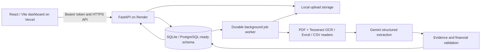

# AI-Powered Document Intelligence System

**Senior AI Engineer take-home assessment | Care Guide**

A working invoice-processing web application that accepts PDF, scanned PDF, image, Excel and CSV documents, reads source content, extracts evidence-backed fields with Gemini, checks financial consistency and duplicates, and supports human review and audited corrections.

**Live demo:** https://ai-document-intelligence-system-rose.vercel.app  
**API health:** https://ai-document-intelligence-api-cjh6.onrender.com/api/health  
**Source code:** https://github.com/JaberAhmad555/ai-document-intelligence-system

The live demo requires a **separately shared reviewer password**. Do not put passwords or API keys in repository files or Vercel variables. The deployment is a time-limited demonstration, **not** a production multi-tenant service.

## Implemented functionality

- **Ingestion:** up to 10 files per request by default; `.pdf`, `.jpg`, `.jpeg`, `.png`, `.tif`, `.tiff`, `.xlsx`, `.xls`, `.csv`; bounded uploads, file validation, SHA-256 metadata and queued jobs.
- **Reading:** digital PDF text extraction; scanned PDF and image OCR through Tesseract; CSV/XLS/XLSX parsing; page/row/sheet provenance and partial OCR warnings.
- **AI:** Google Gemini returns typed structured invoice data (invoice number/date, parties, currency, subtotal, tax, total and line items). Evidence snippets are matched against persisted source units; missing or uncertain fields are preserved rather than invented.
- **Validation:** missing fields, line-item/total arithmetic, uncertainty and potential duplicates (supplier + invoice number). Completed processing does **not** imply validated correctness.
- **Human workflow:** password-protected dashboard, searchable document inbox, processing progress, evidence navigation, manual correction with revision history, optimistic concurrency and idempotent failed-job reprocessing.
- **Operations:** FastAPI, SQLAlchemy and Alembic; durable persisted processing queue with worker leases/retry behavior, React/Vite frontend and Docker deployment to Render.

## Not implemented / limitations

- **Semantic/vector search is not implemented:** `q` uses keyword matching, not embeddings.
- **Dedicated PDF-to-PDF and PDF-to-Excel field-by-field reconciliation is not implemented.** Duplicate detection is not equivalent to cross-document reconciliation.
- Large PDF processing is architecturally supported with streaming/bounded reading; **a 1,000-page production-scale benchmark has not been supplied**.
- The public demo runs **SQLite and local uploads on Render Free**, an ephemeral filesystem. Sleeping/redeploying can erase records and uploaded files. Long-term persistence requires managed PostgreSQL plus durable object storage, and a more suitable worker deployment.
- Shared bearer-token access is for a controlled assessment demo, not per-user accounts, roles, individual attribution or rate limiting. Do not submit confidential financial data.
- Extraction quality, latency and success rates are **dataset-specific**, not implied by automated test counts. See the reproducible evaluator in [`evaluation/`](evaluation/README.md).

## Architecture



The deployed Docker container starts the API and one worker; this is a demo simplification. See [`docs/architecture.md`](docs/architecture.md) and [`docs/database-schema.md`](docs/database-schema.md).

## Technology

**Backend:** Python 3.13, FastAPI, Pydantic v2, SQLAlchemy, Alembic, SQLite (PostgreSQL-ready driver), PyMuPDF, Pillow, Tesseract, openpyxl, xlrd, Google GenAI SDK.  
**Frontend:** React 19, TypeScript, Vite 7, Zod 4, Vitest.  
**Hosting:** Render Docker backend + Vercel frontend.

## Local setup (Windows PowerShell)

Prerequisites: Python 3.13, Node.js 22.12+ or 24+, npm, and Tesseract OCR available in `PATH` (or configured for the reader). Run in the repository root:

```powershell
cd backend
py -3.13 -m venv .venv
.\.venv\Scripts\python.exe -m pip install -r requirements.txt
Copy-Item .env.example .env  # only if .env does not already exist
```

Edit `backend/.env` locally, without committing it. Set **`GEMINI_API_KEY`**, `GEMINI_MODEL=gemini-3.5-flash-lite` (or another model you have verified), and a long URL-safe **`DOCUMENT_API_TOKEN`**. The authentication token must be 32–256 URL-safe ASCII characters (A-Z, a-z, 0-9, `_`, `-`). For local development only you may use `DOCUMENT_AUTH_DISABLED=true` if `APP_ENV=development`; **never disable authentication in production**. Keep `CORS_ORIGINS` as a JSON array of permitted frontend origins.

```powershell
.\.venv\Scripts\python.exe -m alembic upgrade head
.\.venv\Scripts\python.exe -m alembic check
.\.venv\Scripts\python.exe -m uvicorn app.main:app --reload
```

In a **second backend terminal**, run the background processor:

```powershell
.\.venv\Scripts\python.exe -m app.workers --processor app.services.invoice_pipeline:process_document --poll-seconds 2
```

In a **third terminal**:

```powershell
cd frontend
npm ci
Copy-Item .env.example .env  # only if .env does not already exist
npm.cmd run dev
```

Open http://127.0.0.1:5173 and sign in with the local `DOCUMENT_API_TOKEN`. The default `VITE_API_BASE_URL=/` uses Vite's development proxy to `127.0.0.1:8000`.

The Docker image installs Tesseract and invokes Alembic migration `head` before starting the API and worker (`backend/Dockerfile`, `backend/start.sh`). On Vercel, set the root directory to `frontend` and `VITE_API_BASE_URL` to the **backend HTTPS origin without `/api`**. On Render, set `APP_ENV=production`, `DEBUG=false`, `DOCUMENT_API_TOKEN`, `DOCUMENT_AUTH_DISABLED=false`, `GEMINI_API_KEY`, `GEMINI_MODEL`, and `CORS_ORIGINS=["https://ai-document-intelligence-system-rose.vercel.app"]`.

## API outline

| Method / endpoint | Purpose |
|---|---|
| `GET /api/health` | Public liveness probe |
| `GET /api/auth/check` | Verify demo bearer token |
| `POST /api/documents/upload` | Multiple multipart `files` fields; enqueue jobs |
| `GET /api/documents` | Keyword search (`q`), status/type filters and pagination |
| `GET /api/documents/{id}` | Document status and progress |
| `GET /api/documents/{id}/invoice` | AI output, source evidence, effective corrections |
| `GET /api/documents/{id}/validation` | Financial/duplicate/uncertainty issues |
| `GET /api/documents/{id}/content` | Paginated extracted text and provenance |
| `POST /api/documents/{id}/corrections` | Audited, revision-aware correction |
| `GET /api/documents/{id}/corrections` | Revision history |
| `GET /api/documents/{id}/corrections/{revision}` | One revision |
| `POST /api/documents/{id}/reprocess` | Idempotently queue a new attempt for a failed job |

All document endpoints require `Authorization: Bearer <token>`. See `/docs` for schemas; do not put the token in URLs.

## Verification and evaluation

Run locally:

```powershell
cd backend
.\.venv\Scripts\python.exe -m pytest tests -q
.\.venv\Scripts\python.exe -m alembic check
cd ..\frontend
npm.cmd run verify
npm.cmd audit
```

**Observed owner-run checkpoint (October 30, 2026):** 315 backend tests passed (6 skipped), 55 frontend tests passed, the Vite build and TypeScript check passed, and `npm audit` reported zero vulnerabilities. A later deploy of commit `9234118` showed Render Live, and the owner confirmed a working password screen and an unauthenticated `401`. These are observed **test results and smoke checks, not extraction accuracy metrics**.

For reproducible **labeled extraction accuracy, latency and document success/failure rates**, use [`evaluation/README.md`](evaluation/README.md) and [`tools/evaluate_live.py`](tools/evaluate_live.py); commit generated results only after actually running the evaluator. Prior manually observed synthetic examples are recorded separately in [`docs/evaluation.md`](docs/evaluation.md).

## Submission documentation

- [Architecture, data flow and scalability decisions](docs/architecture.md)
- [Relational database schema](docs/database-schema.md)
- [Evaluation methodology and observations](docs/evaluation.md)
- [Reproducible labeled test set](evaluation/README.md)
- [Security and demo access](docs/demo-access-security.md)
- [Manual corrections and retries](docs/review-and-reprocessing.md)
- [AI-assisted development disclosure and prompts](docs/ai-assisted-development.md)
- [Video walkthrough guide](docs/walkthrough-script.md)
- [Final submission checklist](docs/submission-checklist.md)

## AI use and integrity

ChatGPT and Codex Astra assisted with planning, code generation, debugging, tests and documentation; Gemini is the application's runtime extraction service. All claimed executions and deployment outcomes are separated from untested suggestions. Do not treat generated code or the presence of tests as proof of all functional requirements. See the disclosure for details.
