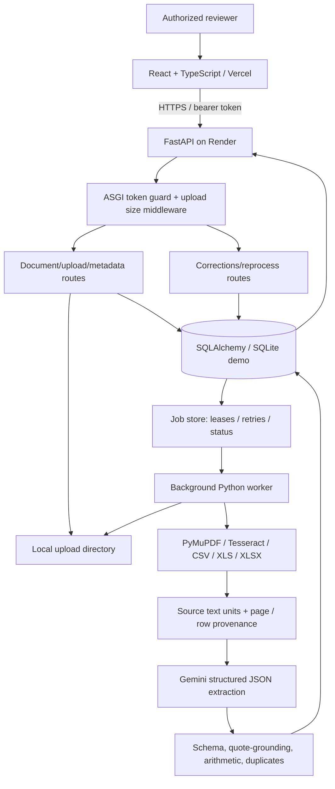

# System architecture and engineering decisions

**Source basis:** the repository snapshot at commit `9234118`, manually observed deployment, and its documented behavior (October 30, 2026). This is an implemented-architecture description, not a claim that all requested production capabilities are complete.

## Component diagram

## Document lifecycle

1. Browser sends an authenticated multipart upload (`files`). FastAPI enforces authentication before parsing, file-count/size limits and type-specific validation; the service saves content under generated paths and SHA-256 digests.
2. One DB transaction records a document and processing job. An HTTP 202 confirms **queued**, not processed.
3. A worker claims a job with persisted lease/fencing state, reads digital PDF text, runs Tesseract where needed, or parses spreadsheets into source units; it records provenance by sequence, page, sheet and row.
4. Gemini receives bounded source chunks and an expected structured schema. Server-side Pydantic models and verified source quotes constrain returned invoice fields.
5. Validation flags missing/unverifiable data, arithmetic disagreement and potential duplicates. Effective results and source evidence are published to the database.
6. A human can inspect source content and amend invoice values; correction revision, original result and audit history are preserved. Failed jobs can be explicitly re-queued by idempotent request without hiding previous failure history.

## Database and concurrency

SQLAlchemy models are migrated by Alembic revisions `0001`–`0004`. Read and update operations use transactions and unique constraints where appropriate; the worker uses durable job state with lease/retry and idempotency. See [`database-schema.md`](database-schema.md).

## Security boundaries

- The shared demo token is validated by ASGI middleware before document routing. The only unauthenticated read surfaces include the health and API description endpoints.
- Production on Render requires a valid `DOCUMENT_API_TOKEN`; no token in the frontend build or `VITE_` configuration. The browser retains it in memory and attaches an Authorization header.
- CORS restricts cross-origin browser access but does not replace bearer authentication. No public-upload authorization bypass should exist.
- No human accounts/RBAC or end-user-specific audit identity. Reviewer labels are **labels**, not cryptographically authenticated identities.
- Prompt injection risks are mitigated by treating document content as untrusted text and source-quote verification; neither proves that the LLM cannot make factual mistakes.
- The shared password, Gemini key and local uploads must not be committed or published in screenshots.

## Why these technologies

FastAPI and Pydantic make typed JSON contracts and clear exception handling. PyMuPDF handles page-by-page PDF text, Tesseract supplies OCR, openpyxl/xlrd supply spreadsheet parsing. Gemini provides structured extraction with evidence cross-checking. A separate job store/worker prevents OCR and LLM calls from blocking upload HTTP requests. React/Vite offers accessible review surfaces without embedding AI credentials. SQLite is adequate for a small single-container demo and portable local tests; PostgreSQL is a planned production storage upgrade, not the current deployed database.

## Production deployment vs target production architecture

**Deployed demo:** one Render Free Docker container starts both API and worker; local SQLite and file uploads are **ephemeral**. Free-service sleep/redeploy may erase files and database history; this is a critical limitation for long-running use. Vercel hosts compiled static frontend assets separately. The backend also depends on a third-party Gemini API, which may be unavailable or rate-limited.

**For serious production use:** separate API and workers; managed PostgreSQL; S3-compatible durable object storage; queue monitoring; rate-limiting, per-user identity and roles; secret rotation; backups; observability; structured tracing; horizontal worker scaling; and security/penetration testing. None of these are claimed as currently deployed.

## Explicitly unfulfilled requests

- `q` search is **keyword-based** SQL filtering, not vector/embedding semantic search.
- Matching duplicate supplier/invoice identifiers is **not** complete PDF-to-PDF or PDF-to-Excel field reconciliation.
- A dedicated measured stress test on approximately 1,000-page invoices has **not** been supplied; support for bounded multi-page reading alone is insufficient evidence for scale/performance claims.
