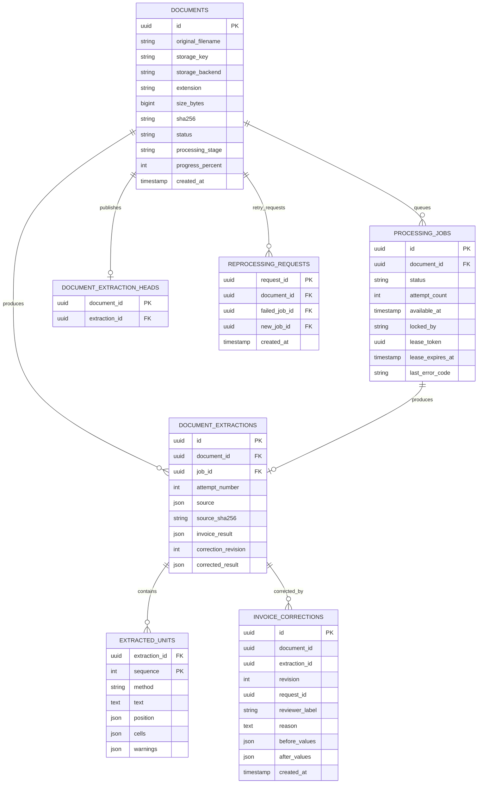

# Relational database schema

**Database:** SQLite for local development and the Render Free demo. SQLAlchemy mappings allow a future PostgreSQL transition, but migrations and operations must be verified there independently. Schema is defined by `backend/app/models/{ingestion,extraction}.py` and Alembic revisions `0001`–`0004`.

## Entity relationship diagram



The diagram is a conceptual ER overview, not a complete DDL dump. Exact foreign keys, unique constraints, indexes, field sizes and nullable conditions are defined in Alembic and SQLAlchemy source.

## Table responsibilities

| Table | Main purpose |
|---|---|
| `documents` | Original metadata, checksum, storage reference, state, progress and errors |
| `processing_jobs` | Durable queue lifecycle, attempts, errors, lease and heartbeat fields |
| `document_extractions` | Processing attempt, source digest, normalized Gemini result and correction snapshot |
| `extracted_units` | Text and source positions (page/sheet/row), OCR/native text, cell metadata, warnings |
| `document_extraction_heads` | Latest published extraction for each document |
| `invoice_corrections` | Audited revisions with reason and original/corrected field values |
| `reprocessing_requests` | Idempotent retry receipt; links prior failed job and new job |

## Persistence and integrity

All invoice amounts are validated as exact decimal strings in API schemas, not binary floats. Job claims and corrections use concurrency rules and transaction boundaries; corrections preserve previous results and an append-only audit history. Source-unit sequence IDs support evidence references. Duplicate checking uses normalized supplier/invoice identifiers across records and may produce warnings rather than deleting invoices.

## Schema verification commands

```powershell
cd backend
.\.venv\Scripts\python.exe -m alembic upgrade head
.\.venv\Scripts\python.exe -m alembic current
.\.venv\Scripts\python.exe -m alembic check
```

**Reported local result:** `0004_invoice_review (head)` and `No new upgrade operations detected` on October 30, 2026. **Reported Render deployment:** migration `0003 → 0004` ran on commit `9234118`.
